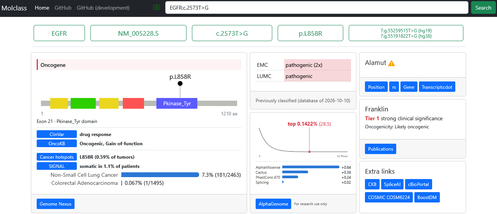
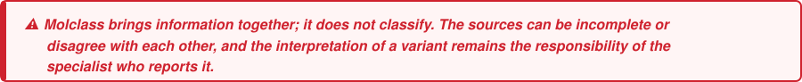

<p align="right">
  <a href="https://www.erasmusmc.nl/"></a>
  &nbsp;&nbsp;&nbsp;
  <a href="https://www.lumc.nl/"></a>
</p>

# Molclass

**One search for everything you need to classify a variant detected in tumour DNA**

G (p.L858R)" width="900">

---

## What is Molclass

A variant detected when tumour DNA is analysed can be somatic or of germline origin. Either way, classifying it means visiting many databases and typing the same variant into each of them. Molclass does that round for you. Enter a variant once, and it collects what the main sources say about it and shows the answers side by side: what is known about the gene and the position, how often the variant is seen and in which tumour types, how other databases interpret it, and where to read further.

Molclass also shows whether one of the participating centres has classified the variant before, and how. That earlier classification is there to support your own assessment, not to replace it: it is one more piece of evidence to weigh, and a reason to look again when it differs from your own conclusion.



## Two ways to take part

| 🖥️ Run Molclass at your centre | 🤝 Share your classifications |
|---|---|
| Get the code and run Molclass on your own server: you choose which sources to show and add your own data files. Nothing leaves your centre. | Join the Erasmus MC and the LUMC in sharing variant classifications. Your classifications would be shown on the *Previously classified* card next to those of the Erasmus MC and the LUMC, so we can learn from each other's assessments. |
| **[How to run it ↓](#run-molclass-at-your-centre)** | **[How to join ↓](#share-your-classifications)** |

## Run Molclass at your centre

### Quick start

You need [Docker](https://docs.docker.com/get-docker/).

```bash
git clone https://github.com/ErasmusMC-Bioinformatics/molclass.git
cd molclass
docker build -t molclass .
docker run -p 8080:8080 molclass
```

Open <http://127.0.0.1:8080> and search for a variant. This works without any configuration, with the public sources. The cards that need a licence, an API key or a data file are switched on as described under [Configuration](#configuration).

### How to search

| Notation | Example |
|---|---|
| Transcript and coding change | `NM_005228.5:c.2573T>G` |
| Gene and coding change | `EGFR:c.2573T>G` |
| Genomic position (hg19) | `chr7:55259515:T:G` |
| dbSNP identifier | `rs121434568` |

The results appear as cards, each from one source, and fill in as the sources answer. The buttons at the bottom of a card open that source at the variant.

### Configuration

Everything is configured with environment variables, for example in an env file passed with `docker run --env-file molclass.env`. Data files are mounted into the container with `-v`.

| Card (in the order on the page) | What you need | Setting |
|---|---|---|
| Tabel 3 (NVVP/VKGL/VKGN) | The table typed over into YAML | `TABLE3_DATABASE` |
| Previously classified | A database of your classifications | `INHOUSE_DATABASE` |
| AlphaGenome | AlphaGenome API key (research use only) | `ALPHAGENOME_API_KEY` |
| Gene lists | Your own gene lists in YAML | `GENE_LISTS` |
| Alamut | Alamut Visual Plus with an API licence | `ALAMUT_IP`, `ALAMUT_INSTITUTION`, `ALAMUT_API_KEY` |
| COSMIC | Cancer Mutation Census file (COSMIC account) | `COSMIC_DATABASE` |
| OncoKB | OncoKB API key | `ONCOKB_API_KEY` |
| HMF hotspots | Hartwig known hotspots file | `HMF_DATABASE` |
| Any card | Switch cards off | `DISABLED_SOURCES=Varsome,Mastermind` |

The details of each setting, and the format of the data files, are in [docs/configuration.md](docs/configuration.md).

## Share your classifications

Molclass was started at the Erasmus MC and is now developed together with the Leiden University Medical Center (LUMC). Both centres use it in their molecular diagnostics and share their variant classifications through it.

Other centres are welcome to join. The more centres take part, the more likely it is that a rare variant has been seen and classified before. And when centres reach different conclusions about a variant, that is a reason for all of them to take another look.

- **What is shared:** for each classified variant only the gene, the chromosome position, the change and the classification. No patient data.
- **How it works:** at the moment the Erasmus MC and the LUMC export their classified variants and combine them into one database. If other centres are interested, we will explore together the best way forward, probably a central Molclass server that shows the classifications of all participating centres.
- **To join:** open an [issue](https://github.com/ErasmusMC-Bioinformatics/molclass/issues), and we'll agree on the details together.

## Development

Molclass is a [FastAPI](https://fastapi.tiangolo.com/) application; every source is a small Python class in [`sources/`](sources/). How the sources work together, and how to add one, is described in [docs/development.md](docs/development.md); how the Erasmus MC runs it in production in [docs/production.md](docs/production.md).

```bash
pip install -r requirements/requirements.txt
uvicorn main:app --reload --port 8585
```

---

<p>
  <sub>DEVELOPED BY</sub><br><br>
  <a href="https://www.erasmusmc.nl/"></a>
  &nbsp;&nbsp;&nbsp;&nbsp;&nbsp;&nbsp;
  <a href="https://www.lumc.nl/"></a>
</p>
